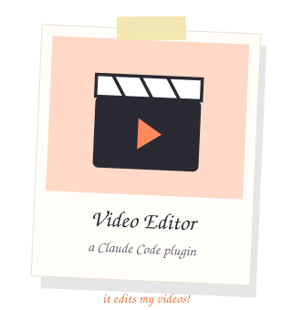
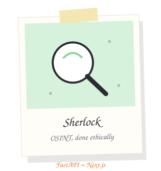
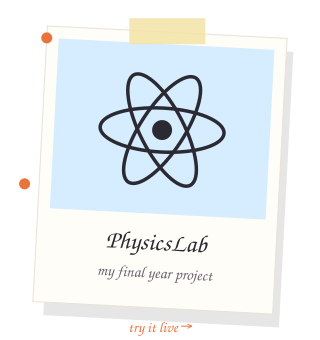
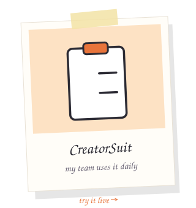
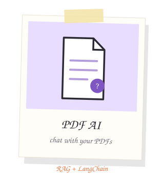

  

### a little about me ☕

I'm **Rao Ali Hassan**, a developer from **Lahore, Pakistan**. I studied Physics at COMSATS, fell in love with building software along the way, and now spend my days making things with AI — and showing other people how to make them too.

Right now I'm **Technical Lead at [Aaghaz AI](https://aaghaz.ai)**, where I lead a small team of editors and designers, make YouTube videos and courses about AI tools and work with AI brands on sponsored videos.

What I enjoy most is the full journey: a messy idea → a working prototype → something real people actually use.

  

### things I've made 🛠️

  
  
  
  
  
  

a few short notes on each

 

- **[Thunder](https://github.com/MaximumCell/thunder)** — you describe the video you want, an AI agent helps you shape the idea, then Seedance and Seedream bring it to life on a canvas. *Next.js, Supabase, Gemma 4.*
- **[Video Editor plugin](https://github.com/MaximumCell/Claude-editing-Skill)** — I got tired of cutting retakes by hand, so I taught Claude Code to do it: it cuts silences, adds B-roll and motion graphics, and renders the video. *Remotion, Node.js.*
- **[Sherlock](https://github.com/MaximumCell/sherlock)** — an investigation tool that pulls public OSINT data, scores how confident each link is, and keeps a human in the loop. Built with strict ethics rules. *FastAPI, Next.js.*
- **[PhysicsLab](https://github.com/MaximumCell/My-FYP)** — my final year project: an AI physics tutor, live 2D/3D simulations and a little ML lab. *Next.js, Flask, TensorFlow.*
- **[CreatorSuit](https://github.com/MaximumCell/Creator_Suit)** — a small internal tool my team at Aaghaz AI uses every day. *Next.js, Supabase.*
- **[PDF AI](https://github.com/MaximumCell/pdf-ai)** — upload a PDF and ask it questions. *LangChain, Gemini, MongoDB vector search.*

Older things: [Bluntly](https://github.com/MaximumCell/Bluntly) · [GYM-Buddy](https://github.com/MaximumCell/GYM-Buddy) · [Sellify](https://github.com/MaximumCell/Sellify) · [Bettify](https://github.com/MaximumCell/bettify) · [dev-blog](https://github.com/MaximumCell/dev-blog)

### things I teach 🎓

I've written a **15-hour Claude course**, a **15-hour vibe-coding course**, and a **90+ lesson Claude Code curriculum** — plus live workshops on automation and building with AI. Teaching is honestly how I learn best.

### what I'm learning right now 📚

System design · SQL and caching · how to give AI agents better memory

### tools I reach for 🧰

  

…and Claude Code, LangChain, n8n and MCP for the AI side of things

### say hi 👋

I'm **open to new work** — AI engineering, full-stack, or AI automation, in Lahore or remote.
The easiest way to reach me is **[LinkedIn](https://www.linkedin.com/in/ali-hassan-36a43b318/)** or **[alihassanwinner@gmail.com](mailto:alihassanwinner@gmail.com)**.

 

  <picture>
    <source media="(prefers-color-scheme: dark)" srcset="https://raw.githubusercontent.com/MaximumCell/MaximumCell/output/github-snake-dark.svg" />
    <source media="(prefers-color-scheme: light)" srcset="https://raw.githubusercontent.com/MaximumCell/MaximumCell/output/github-snake.svg" />
    
  </picture>
   and here's a snake eating my commits 🐍

