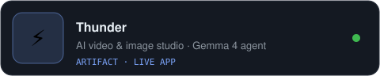
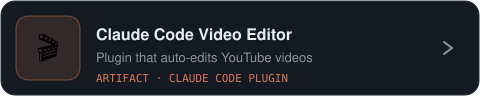
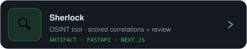
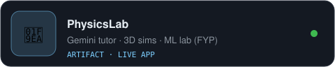
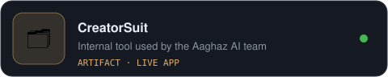
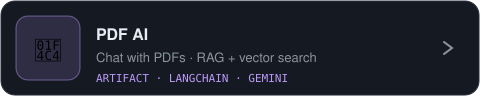

<p align="center">
  <picture>
    <source media="(prefers-color-scheme: dark)" srcset="./assets/v2/chat-dark.svg" />
    <source media="(prefers-color-scheme: light)" srcset="./assets/v2/chat-light.svg" />
    
  </picture>
</p>

<p align="center">
  <picture>
    <source media="(prefers-color-scheme: dark)" srcset="./assets/v2/prompts-dark.svg" />
    <source media="(prefers-color-scheme: light)" srcset="./assets/v2/prompts-light.svg" />
    
  </picture>
</p>

<p align="center">
  <a href="https://www.linkedin.com/in/ali-hassan-36a43b318/"></a>
  <a href="mailto:alihassanwinner@gmail.com"></a>
  
  
</p>

---

### 📜 System prompt

```yaml
# ali-agent / system_prompt.yaml
you_are: Rao Ali Hassan
based_in: Lahore, Pakistan
role: Technical Lead @ Aaghaz AI        # AI-education YouTube brand
responsibilities:
  - build AI products end to end — LLM agents, RAG pipelines, MCP tools
  - lead a content team and sponsored campaigns with AI brands
  - host a podcast with Pakistan's founders and tech leaders
teaches:
  - 15-hour Claude course
  - 15-hour vibe-coding course
  - 90+ lesson Claude Code curriculum
currently_learning: [system design, SQL & caching, memory for AI agents]
open_to: [AI Engineer, Full-Stack, AI Automation]   # Lahore or remote
```

---

### 🗂️ Artifacts

<table>
<tr>
<td width="50%"><a href="https://thunder-nine-olive.vercel.app"><picture>
    <source media="(prefers-color-scheme: dark)" srcset="./assets/v2/artifact-thunder-dark.svg" />
    <source media="(prefers-color-scheme: light)" srcset="./assets/v2/artifact-thunder-light.svg" />
    
  </picture></a></td>
<td width="50%"><a href="https://github.com/MaximumCell/Claude-editing-Skill"><picture>
    <source media="(prefers-color-scheme: dark)" srcset="./assets/v2/artifact-claude-video-dark.svg" />
    <source media="(prefers-color-scheme: light)" srcset="./assets/v2/artifact-claude-video-light.svg" />
    
  </picture></a></td>
</tr>
<tr>
<td width="50%"><a href="https://github.com/MaximumCell/sherlock"><picture>
    <source media="(prefers-color-scheme: dark)" srcset="./assets/v2/artifact-sherlock-dark.svg" />
    <source media="(prefers-color-scheme: light)" srcset="./assets/v2/artifact-sherlock-light.svg" />
    
  </picture></a></td>
<td width="50%"><a href="https://physics-lab-six.vercel.app"><picture>
    <source media="(prefers-color-scheme: dark)" srcset="./assets/v2/artifact-physicslab-dark.svg" />
    <source media="(prefers-color-scheme: light)" srcset="./assets/v2/artifact-physicslab-light.svg" />
    
  </picture></a></td>
</tr>
<tr>
<td width="50%"><a href="https://creator-suit.vercel.app"><picture>
    <source media="(prefers-color-scheme: dark)" srcset="./assets/v2/artifact-creatorsuit-dark.svg" />
    <source media="(prefers-color-scheme: light)" srcset="./assets/v2/artifact-creatorsuit-light.svg" />
    
  </picture></a></td>
<td width="50%"><a href="https://github.com/MaximumCell/pdf-ai"><picture>
    <source media="(prefers-color-scheme: dark)" srcset="./assets/v2/artifact-pdf-ai-dark.svg" />
    <source media="(prefers-color-scheme: light)" srcset="./assets/v2/artifact-pdf-ai-light.svg" />
    
  </picture></a></td>
</tr>
</table>

<details>
<summary><b>Older artifacts</b></summary>
<br/>

| Project | What it is | Stack |
|---|---|---|
| [Bluntly](https://github.com/MaximumCell/Bluntly) · [live](https://bluntly-phi.vercel.app) | Social app with real-time chat & media | React Native · Node.js · MongoDB |
| [GYM-Buddy](https://github.com/MaximumCell/GYM-Buddy) · [live](https://gym-buddy-virid.vercel.app) | Fitness tracker with a voice assistant & RAG tutor | React · LangChain · Qdrant · VAPI |
| [Sellify](https://github.com/MaximumCell/Sellify) | E-commerce with Stripe, Redis sessions & admin analytics | MERN · Redis · Stripe |
| [Bettify](https://github.com/MaximumCell/bettify) | Spotify clone with real-time features | MERN · TypeScript |
| [ai-tools-setup](https://github.com/MaximumCell/ai-tools-setup) | Local Ollama assistant with tool calling | Python · Ollama |
| [dev-blog](https://github.com/MaximumCell/dev-blog) · [live](https://dev-blog-two-indol.vercel.app) | My learning blog | Next.js 16 · Supabase · Clerk |

</details>

---

### 🔧 Tools available to this agent

<p align="center">
  <br/>
  
</p>

<p align="center">
  
  
  
  
  
  
  
</p>

---

### 🎓 Training data

<details>
<summary><b>Courses I've created</b></summary>
<br/>

- **Claude course** — 15 hours, 8 modules, beginner to advanced
- **Vibe-coding course** — 15 hours, project-based: full-stack, mobile and deployment
- **n8n · Claude Code · AI agents curriculum** — 3 tiers, 12-module Claude Code outline with 90+ lessons
- **Claude for Lead Generation** — Claude, Clay, Firecrawl, Supabase
- **Live AI workshop** — automation, live vibe-coding and n8n

</details>

**Certifications:** LangChain Academy (2026) · DeepLearning.AI — LangChain for LLM Apps (2025) · Kaggle — Intro to Deep Learning (2025) · AWS Academy Cloud Foundations

---

### 📈 Usage logs

<p align="center">
  
  
</p>

<p align="center">
  <picture>
    <source media="(prefers-color-scheme: dark)" srcset="https://raw.githubusercontent.com/MaximumCell/MaximumCell/output/github-snake-dark.svg" />
    <source media="(prefers-color-scheme: light)" srcset="https://raw.githubusercontent.com/MaximumCell/MaximumCell/output/github-snake.svg" />
    
  </picture>
</p>

<p align="center"><sub>⏎ end of session · built with Claude Code · artwork generated by <a href="./scripts/build_assets_v2.py">scripts/build_assets_v2.py</a> · previous design saved in <a href="./designs/v1-terminal">designs/v1-terminal</a></sub></p>
